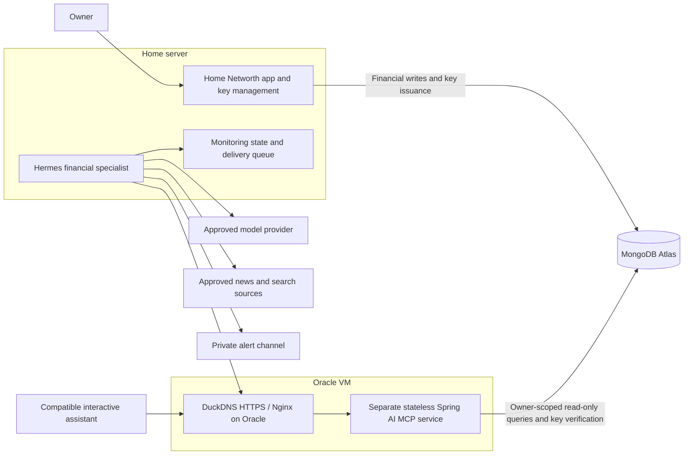

# AI Portfolio Analysis and Market Monitoring Plan

**Date:** 2026-11-01  
**Status:** Proposed design; implementation is not authorized by this document.  
**Goal:** Let compatible assistants analyze Networth data alongside market news, and let a Hermes financial specialist run bounded, read-only checks and send useful alerts.  
**Architecture:** Revised proposal: Networth and Hermes stay at home; MongoDB moves to Atlas Free; a separate, stateless Spring Boot/Spring AI MCP application runs on Oracle Cloud behind Nginx and a stable DuckDNS hostname. Networth issues owner-scoped API keys, persisted as verification records in Atlas, so MCP can validate credentials and read financial data without calling the home server. Research, scheduling and notifications remain with consuming agents.
**Stack:** Java/Spring Boot/Spring AI, Maven, MongoDB Atlas, existing React frontend, Docker, Nginx, DuckDNS and TLS. Select mutually compatible maintained versions before implementation.

**Revision:** Incorporates the user's separate-service/Atlas/Oracle proposal on 2026-11-01. Supersedes the earlier backend-embedded MCP and optional-gateway deployment. No infrastructure has been migrated.

## 1. Decisions, assumptions and open questions

### Confirmed by the user

- MCP is preferred over building chat inside Networth.
- Intended consumers include Google Gemini, OpenAI ChatGPT and Hermes agents.
- Analysis should combine specific market news with portfolio impact and possible actions.
- Hermes should routinely check the portfolio and alert on relevant market events.
- Networth and Hermes will run on the home server.
- MongoDB should move from the local container to Atlas Free, subject to capacity, connectivity and recovery validation.
- MCP should be a separately deployed Spring Boot/Spring AI application on Oracle Cloud.
- Expose MCP through Nginx, HTTPS and a DuckDNS hostname.
- The home Networth application should generate API keys for MCP access.
- MCP should remain stateless and read the database for each request.

### Recommended defaults, subject to approval

- Personal, single-owner deployment initially; still authenticate every MCP consumer.
- Read-only tools. No trading, transfers, broker orders, portfolio edits or automatic rebalancing.
- Prove authenticated Hermes access to the Oracle MCP endpoint first; one interactive client next.
- Separate deployment improves release isolation, but shared database access still couples both applications to schemas and financial definitions. Use a small shared read-model/calculation library where needed; do not copy formulas.
- Start with daily monitoring, not continuous trading signals. A schedule is not a real-time market-event guarantee.
- Send minimal relevant holdings to cloud models; home hosting does not mean analysis stays local.
- No vector database, RAG pipeline, agent swarm or new chat UI for the MVP.

### Decisions still required before implementation

| Decision | Why it matters | Suggested starting point |
|---|---|---|
| Exact Gemini and ChatGPT products/plans | Consumer chat, CLI and API support differ | Prove one real connection before infrastructure work |
| Hermes repository/version and installation | MCP, scheduling, isolation and notification support must be verified | Use existing supported capabilities, not a replacement scheduler |
| Owner authentication / identity provider | Existing dummy identity is not an authorization boundary | Maintained OIDC/OAuth solution; map verified identity to existing owner |
| API-key support in each client | Some clients require OAuth rather than arbitrary authorization headers | API keys for supported clients; a standards-based OAuth path only if the selected client requires it |
| Atlas region, limits and backups | Free service limits and cross-cloud latency affect viability | Measure storage, indexes, connections and latency; prove backup restoration before migration |
| Home public egress IP | Atlas network allow-list must track it securely | Restrict current egress IP or route database traffic through controlled static egress |
| Cloud-data consent | Portfolio data enters provider processing and possibly chat history | Explicit provider-by-provider approval |
| Alert channel | Delivery security and metadata exposure differ | One existing private Hermes channel |
| Monitoring scope | Broad news scanning creates noise and cost | Direct holdings events, concentration, data freshness |
| Timezone and schedule | Home uptime, markets and daylight saving affect checks | Explicit timezone; one daily run plus weekly digest |
| Research provider and budget | Citation quality, licensing and API costs | One approved source/search integration; hard budget before enabling |
| Risk profile and target allocation | Personalized action suggestions need context | User-entered targets; never infer risk tolerance from holdings |

## 2. Current codebase and constraints

Static inspection informs this plan; no runtime or security tests were performed during planning.

| Existing component | Reuse / limitation |
|---|---|
| `backend/src/main/java/com/networth/service/CalculationService.java` — `calculate(String userId)` | Current dashboard calculations. Reuse financial logic, but audit currency semantics before exposing authoritative totals. |
| `backend/src/main/java/com/networth/service/SnapshotService.java` | `getSnapshots`, `getLatest`, `takeSnapshot`; aggregate history, not a holding-by-holding price or position history. Monthly job currently runs at 00:05 on the first day without an explicit timezone. |
| `backend/src/main/java/com/networth/filter/DummyUserFilter.java` | Sets a request attribute for `dummy-local-dev`; does not establish a verified security principal. |
| `backend/src/main/java/com/networth/controller/CasImportController.java` — `getTransactions` | Transaction lookup lacks an ownership check; fix before exposing related data. |
| `backend/src/main/java/com/networth/model/document/UserSettingsDocument.java` | Contains currency and retirement/return/inflation assumptions. Does not contain investment risk tolerance, mandates or monitoring consent. |
| `backend/api/networth-api.yaml` | Existing REST contract. Its security declaration must match actual enforcement; it is not proof authentication exists. |
| `docker-compose.yml` | Currently publishes frontend 5050, backend 6060, parser 7070 and MongoDB 27017 without localhost-only bindings. Review exposure before connecting agents. |

Data constraints that every analysis must respect:

- Investment/asset values are stored observations, not guaranteed live quotes.
- Recurring income/expense entries are budget assumptions, not a dated spending ledger.
- Aggregate snapshot changes are not investment returns: contributions, withdrawals and edits also change net worth.
- Mutual-fund transaction coverage depends on imported statements; missing transactions invalidate precise performance claims.
- Allocation categories can overlap. Do not sum them as if they were mutually exclusive asset classes.
- Existing INR fallbacks and liability rollups can mix currencies. Reject unsupported consolidated calculations or clearly mark them unavailable until conversion is implemented and tested.
- Mutual-fund ownership does not establish current company-level exposure. Look-through analysis needs dated fund-composition data and coverage weights.
- Updated-at timestamps are not necessarily market valuation timestamps. Preserve that distinction.

## 3. Deployment and connection strategy

### Separate service and statelessness

- Create `mcp-server/` as an independently buildable Maven application and container. Use Spring AI's maintained MCP server integration; this application needs no model API key or chat memory.
- Select and test the stateless Streamable HTTP mode supported by the chosen Spring AI release. Do not rely on in-memory protocol sessions, sticky routing, conversation history or local portfolio caches.
- Each tool execution authenticates the caller, resolves its owner/scopes, queries permitted Atlas records and maps them to minimized responses. Financial data is queried afresh; database connection pooling is allowed and required for sensible operation.
- Read-only deterministic calculations are compatible with statelessness. “Always from DB” means no invented or cached portfolio facts, not raw documents returned without validation.
- No per-request call to the home app is required. Existing issued keys work while home is offline; creating/revoking keys through the home app and refreshing holdings do not.
- Home import, price-refresh and snapshot jobs remain home responsibilities. Cloud-hosted MCP availability does not make those datasets live or keep Hermes running during a home outage.
- Begin with one MCP replica. Independent scaling is possible but constrained by shared Atlas capacity and pool sizes; do not add orchestration or autoscaling for a personal workload.

### Shared database contract and calculations

- The home backend owns financial writes and migrations. MCP gets a distinct Atlas database credential with only required collection read privileges, including API-key verification records. No write, index creation or migration privileges.
- Database authentication and caller API keys are separate credentials. Never expose an Atlas URI/password to an assistant.
- Atlas collection permissions are not row-level user isolation. Every financial query must filter by the owner resolved from the credential; object IDs alone are insufficient.
- Share only stable read DTOs and pure financial formulas when reuse is needed, potentially through a small `portfolio-core/` Maven library. Do not share controllers, mutable application services or a full backend dependency.
- Shared-library versions and golden-value contract tests prevent formula drift; release compatibility tests prevent schema drift. Prefer additive changes, deploy readers before incompatible writer changes, and document the supported schema version.
- Read tools must tolerate missing optional fields and reject unsupported breaking schema versions rather than silently miscalculating.
- Existing dashboard calculation services cannot simply be called across the process boundary. Extract pure functions or define equivalent read models with parity tests before exposing calculated tools. Do not introduce home REST calls as an unnoticed runtime dependency.

### Atlas Free migration and operations

- Validate current Free-cluster storage/index allowance, throughput, concurrent connections, transfer limits, availability of region and recovery/export methods against official documentation and the actual account. Do not assume paid-tier features such as managed backups, private endpoints or point-in-time recovery are included.
- Measure local data plus index size and expected import/snapshot growth. Approve a paid-tier or alternative fallback before limits are reached; free tier is a starting budget choice, not a scale guarantee.
- Choose a region near Oracle and acceptable for personal-data residency. Test home-to-Atlas and Oracle-to-Atlas latency using representative queries.
- Allow-list Oracle's actual outbound public IP and home's actual outbound public IP. DuckDNS does not replace Atlas IP access rules. Never solve dynamic home addressing by opening `0.0.0.0/0`.
- For dynamic home egress, choose a narrowly privileged allow-list updater with stale-entry cleanup or controlled static egress/VPN routing. Evaluate CGNAT, updater failure and the extra dependency introduced by routing through Oracle.
- Require TLS verification. Use separate home read/write and MCP read-only credentials, plus temporary migration/admin credentials; least privilege applies to backup automation too.
- Bound connection pools per application and replica; use server-selection/query timeouts and backoff. Fail closed on Atlas outage, including key-verification failure, without serving stale authentication or fabricated empty portfolios.
- Before cutover: create an encrypted backup, restore to a test database, compare per-owner counts, identifiers, indexes, dates and calculation totals. Preserve existing IDs and document references.
- During cutover: stop home writes and scheduled jobs, perform final export/import, verify counts and totals, switch the configured URI, smoke-test reads/writes, then resume jobs. No dual-write implementation.
- Keep the old database offline/read-only for a bounded rollback period. After new writes occur in Atlas, rollback requires write quiescence and reconciliation/export of those changes; switching back to an old URI alone would lose data.
- Establish an automated encrypted backup outside the Atlas account with a documented supported export method and restore test. Proposed personal-use recovery targets: no more than 24 hours of data loss and recovery within 24 hours; approve or change these before cutover.
- Alert on backup age, storage/index growth, failed imports, connection pressure and sustained query latency. Cloud storage also changes privacy exposure and must be explicitly accepted.

### Oracle, DuckDNS and Nginx

- DuckDNS supplies a stable hostname whose DNS record points at Oracle's public IP. It is not a rotating application URL or a security mechanism. Use a reserved public IP where available; otherwise automate updates and monitor DNS drift.
- Nginx terminates valid publicly trusted TLS and proxies only MCP plus necessary authorization metadata routes. Automate certificate renewal and test renewal failures; keep the DuckDNS update token private.
- Configure OCI network rules and the host firewall for HTTPS, restricted administration, and HTTP only if needed for certificate validation/redirects. Bind the MCP application to loopback or a private container network; do not expose its internal port.
- Set body/connection/rate limits, appropriate streaming timeouts and disabled response buffering where required by the selected transport. Forward authorization safely and accept forwarded host/scheme headers only from the trusted proxy.
- Do not cache tool responses or log authorization headers, request/response bodies, secrets or financial query parameters. Expose no public Actuator diagnostics or database endpoints.
- Apply security updates, non-root containers, resource limits, bounded log retention and restart policies. Test Oracle VM architecture compatibility for the image, DNS and TLS before rollout.
- The Oracle VM is now the MCP application host, not a tunnel gateway. No connection back to the home backend is required for tool execution. Single-VM, DNS and Atlas outages remain availability risks; free cloud resources are not a high-availability design.
- Keep home frontend/key-management APIs private to LAN/VPN unless separately secured. Keep the CAS parser internal and remove unneeded local MongoDB production port mappings after cutover.

### Interactive cloud clients: verify first

| Client surface | Connection implication |
|---|---|
| Local MCP-capable app/CLI | Connects to the Oracle HTTPS endpoint with a securely configured credential. Confirm supported transport and authentication. |
| Hermes calling a cloud model | Hermes retrieves tool results from Oracle and sends permitted data to the model. Model API compatibility is separate from native MCP support in a consumer chat app. |
| OpenAI Responses API | Official documentation describes remote MCP and a Secure MCP Tunnel option for supported products. This does not prove availability in the user's ChatGPT plan or interface. |
| ChatGPT consumer interface | Verify custom connector/app availability, approval behavior, authentication and tunnel support in the actual account. |
| Gemini API / SDK | Function-calling documentation describes MCP integration for supported SDK workflows. This is not evidence of arbitrary MCP connectors in the consumer Gemini app. |
| Gemini consumer interface | Treat direct integration as unverified until demonstrated. Use a supported local/API agent if direct consumer integration is unavailable. |

Do not promise “works with any chatbot.” Record product, account tier, client version, transport, auth method and successful tool-call evidence for each supported client.

The chosen public Oracle endpoint removes the need for a home tunnel for compatible hosted clients. It does not remove client authentication limitations. API keys work only where clients allow securely configured authorization headers; clients requiring MCP OAuth need a compatible authorization server/resource-server flow. Never insert a key into a prompt or URL to work around missing support.

### Design challenges accepted with safeguards

| Proposal | Assessment | Required safeguard |
|---|---|---|
| Atlas Free | Reasonable for a measured personal dataset; adds internet dependency to the home app | Capacity checks, IP allow-list, backup/restore and rollback gates |
| Separate Spring AI service | Valid operational separation, not independent data ownership | Shared schema contract, formula parity tests and read-only DB role |
| Oracle + DuckDNS + Nginx | Practical public deployment | Stable hostname, TLS renewal, restricted ports and authentication |
| Home-issued API keys | Practical for Hermes/header-capable clients | Hashed verification records in Atlas; explicit owner/scopes; expiry/revocation; OAuth compatibility gate |
| Stateless DB reads | Appropriate | No session affinity or portfolio cache; pooled connections, per-request auth, bounded owner-scoped queries and freshness metadata |

## 4. MCP tool contract

Expose business-level questions, not raw MongoDB queries, arbitrary URLs or generic REST execution. Use typed, bounded inputs and explicit response schemas.

### Initial tools

| Proposed tool | Inputs | Output |
|---|---|---|
| `get_financial_summary` | Optional supported reporting currency; default stored preference | Net worth, component totals, budget/savings, runway and FIRE assumptions; invalid mixed-currency metrics withheld |
| `get_portfolio_holdings` | Optional instrument/type filter; bounded cursor pagination | Stable holding ID, instrument identifiers where available, type, units/value/currency, valuation provenance and known classifications |
| `get_networth_history` | Bounded date range and result limit | Aggregate snapshots, actual observation dates, missing periods and coverage caveats |
| `get_budget_and_liabilities` | Optional bounded category filter | Recurring budget assumptions, outstanding balances, rates/EMIs and known loan attributes; exclude account identifiers |

### Add only when a validated question requires them

- `get_investment_transactions`: owner-scoped holding ID, date range, type and pagination; disclose statement coverage. Do not expose raw statement descriptions containing personal information without minimization.
- `evaluate_financial_scenario`: allow-listed parameters such as monthly expense change; pure calculation with explicit assumptions and no persistence. Implement and validate formulas server-side before publishing this tool.
- Fund constituent look-through: separate data-source feature with dated disclosures and confidence rules, not an LLM guess.

### Common response metadata

- `schemaVersion`, `generatedAt`, reporting currency, and a request/correlation identifier.
- Per-source or per-value valuation date, source, and freshness status. Use unknown rather than inventing timestamps.
- `coverage` and `warnings`: unsupported currencies, missing imports, overlapping categories, incomplete history and partial results.
- Stable IDs for follow-up queries; no user identity supplied by the caller.
- Distinguish zero, unavailable and unknown values; never convert an upstream failure into an empty portfolio.
- Prefer decimal-safe monetary serialization and tested rounding rules. Avoid a wholesale money-type migration unless required for correctness.
- Bounded limits and date ranges, structured validation errors, stable pagination and payload budgets.

Read-only MCP calls must not invoke snapshot creation, price refresh, imports or any other write as a side effect. If multiple underlying reads can observe different revisions, identify the consistency limitation; do not imply an atomic portfolio snapshot.

## 5. Authentication, authorization and privacy requirements

These are implementation gates, not a completed security audit.

### Identity and access

- Replace or explicitly disable dummy-user bypass on all exposed paths. Authenticated MCP methods receive the owner identity from verified credentials, never from a tool argument.
- Preserve existing financial records when migrating `dummy-local-dev` to the real owner. Back up first, explicitly link the owner, test record counts/totals and provide rollback.
- For interactive remote clients, implement the authorization flow supported by the current MCP specification and actual client, using maintained OAuth/OIDC components. Validate issuer, audience, expiry and granted scopes; do not invent a custom OAuth server.
- For Hermes, use a home-issued API key with read-only scopes, fixed owner mapping, expiry and revocation as specified below. API keys are not a universal substitute for remote MCP OAuth.
- Separate summary access from detailed holdings/transaction access where practical. Give Hermes only the tools it needs.
- Check ownership for every holding/transaction lookup, including existing REST routes. Test two distinct users even though initial deployment has one owner.
- Disable unnecessary generic filesystem, shell, broker and outbound messaging tools in the unattended specialist context. If Hermes cannot enforce separate tool permissions, document and resolve that isolation gap before unattended operation.

### Home-issued API-key lifecycle

- Authenticate the real owner before enabling generation, listing, rotation or revocation. The current dummy-user endpoint pattern must not grant key-management access. Apply CSRF protection when cookie-based authentication is used.
- Generate a cryptographically random secret of at least 256 bits. Show the full key exactly once over the authenticated connection; keep it only in the consuming client's secret store.
- Use a public random key ID plus secret. Store only a cryptographic digest of the high-entropy secret, owner ID, allowed scopes, label/client, created/expiry timestamps and revoked status in an `mcpApiKeys` collection. Never persist the plaintext key. Password hashing requirements differ from hashing a uniformly random high-entropy API secret; use a reviewed verification design and constant-time comparison.
- The home backend may create/update owner-scoped verification records. MCP can read them but cannot issue, update or revoke keys. MCP must not update a last-used field; keep redacted access audit metadata in operational logs instead.
- Each authenticated HTTP/tool request looks up the record in Atlas, verifies the secret, expiry, revocation and scopes, then establishes an immutable owner context for all queries. Avoid positive credential caches in the initial version. Missing database access fails closed.
- Validate revocation at tool execution as well as connection establishment. A request already authorized may finish; do not promise recall of an already-sent response. Revocation applies to subsequent requests once its database write is visible; configure and test read/write consistency accordingly.
- Issue separate keys per client. Rotation creates a new key, updates the client, then revokes the old one with an explicitly bounded overlap. Proposed maximum lifetime: 90 days; confirm the user's rotation workflow.
- List only labels, IDs/prefixes, scopes, expiry and status. Allow immediate revoke with confirmation; never redisplay full secrets.
- A stolen read-only key can still disclose financial information. Rate limits and per-client scopes reduce impact but do not replace secure storage.
- Home outage prevents normal issuance/revocation UI access, although Oracle MCP can still validate existing keys. Document an emergency Atlas-admin revocation procedure using a separate secured admin identity, and test it without exposing that credential to MCP or Hermes.
- REST management endpoints (proposed): `POST /api/mcp-keys`, `GET /api/mcp-keys`, `DELETE /api/mcp-keys/{id}`. Deletion means revocation; rotate by create/update-client/revoke. Update OpenAPI, ownership tests and UI together.
- API-key format is an application credential contract, not an OAuth access token. If a client requires OAuth, use maintained authorization infrastructure and client-specific consent; do not build an ad-hoc key-to-OAuth facade.

### Data handling and retention

- Exclude PAN, email, bank/account numbers, folio identifiers where unnecessary, raw CAS PDFs, passwords, broker tokens and credentials from MCP output.
- Sanitize free-text instrument names, descriptions and imported content as untrusted data; they may contain instructions or private details.
- Never embed portfolio facts or identifiers in news search queries unless required and explicitly approved. Search public instrument/company identifiers, not personal positions or wealth.
- Use HTTPS or a deliberately trusted private transport with network restrictions; home LAN membership is not authentication.
- Apply host/origin checks appropriate to MCP transport, request size/time limits, rate limiting and secure error responses. CORS is not authentication.
- Store secrets outside Git and images; redact logs and environment diagnostics. Do not put tokens in URLs.
- Obtain consent for each provider's processing, retention and conversation-memory behavior. External assistants may retain context beyond token revocation; revocation prevents future access, not deletion of past disclosures.
- Define retention before enabling monitoring: suggested 30 days for operational logs and 90 days for alert metadata, adjustable by the owner. Do not persist full prompts/portfolio payloads by default.
- Encrypt backups, restrict access and perform a restore test. Agent-readable data should not include backup credentials.

### Agent safety

- News and tool results are evidence, never instructions. Retrieved content cannot authorize new tools, change policy, reveal secrets or modify recipients.
- Use fixed notification destinations and allow-listed research tools. No arbitrary article-driven HTTP calls or attachment execution.
- Explicitly allow-list unattended read-only MCP tools; interactive tool approvals remain enabled where supported for sensitive access.
- Start with synthetic portfolios for prompt-injection and data-exfiltration tests.

## 6. Interactive analysis behavior

For a supplied news URL or question:

1. Identify the event, publication time, effective date and original source. Distinguish commentary, rumor and confirmed announcement.
2. Fetch the minimum relevant portfolio facts, not the full profile by default.
3. Match identifiers and dates. Classify exposure as direct, verified indirect, inferred or unknown.
4. Explain plausible mechanisms and alternative outcomes; avoid precise price predictions without a defensible model.
5. Report measured values separately from illustrative scenario assumptions.
6. Offer bounded options, including no action, with trade-offs, liquidity implications and uncertainty.
7. Cite sources and portfolio valuation dates. State when the evidence is insufficient to recommend action.

Example: a policy-rate announcement can justify reviewing floating-rate debt, but the current loan fields may not establish fixed/floating status or lender reset timing. Ask for that context rather than claiming the EMI will change immediately.

Risk tolerance, time horizon, emergency needs, target allocation, tax jurisdiction and transaction costs are required context for personalized buy/sell guidance. Tax-specific or irreversible decisions should be reviewed by an appropriately qualified professional. No recommendations are executed automatically.

## 7. Hermes monitoring workflow

### MVP scope

- One dedicated financial specialist with a narrow prompt and tool allow-list.
- One daily run at an explicitly selected timezone; weekly digest can initially use the same stored event history.
- Direct holding/company/fund events, user-defined concentration thresholds, and stale/incomplete financial data.
- Optional macro events only when linked to known exposure and a clear mechanism.
- No intraday trading, broad web crawling, return forecasting or guaranteed immediate detection.

### Run sequence

1. Acquire a single-run lock and check budget, schedule and credential status.
2. Read the portfolio and freshness metadata. If unavailable or materially stale, suppress unsupported valuation advice and report monitoring degradation.
3. Build a public-identifier watch list from known holdings; keep unknown mappings explicit.
4. Search approved sources over a bounded window, with overlap to catch late indexing. Distinguish event time, publication time and discovery time.
5. Normalize candidate events: issuer/instrument, event type, effective date, source URL and source publication date.
6. Require a credible primary source where possible; seek corroboration for uncertain claims. Multiple syndicated copies do not constitute independent confirmation.
7. Match exposures deterministically when identifiers exist. Label indirect or inferred links and exclude unsupported look-through claims.
8. Apply user-configured significance thresholds before using a model for explanation.
9. Produce a structured assessment and validate required evidence, exposure and uncertainty fields.
10. Suppress duplicates, persist pending delivery state, send to the fixed channel and mark delivery success.
11. Record run outcome and checkpoints; provide bounded catch-up after downtime rather than replaying unlimited missed schedules.

### Alert format

- **Event:** concise factual description, occurrence/publication dates and cited source.
- **Exposure:** affected holding(s), direct/indirect classification, amount or allocation when valid, valuation date.
- **Impact:** plausible mechanism, materiality and counterarguments.
- **Review options:** what to verify or consider, including no action; no executable trade instructions.
- **Confidence:** evidence quality and mapping confidence, not an invented probability of profit/loss.
- **Limitations:** missing data, stale prices, incomplete fund composition or personal suitability context.

### Deduplication and delivery

- Prefer a stable event key built from issuer, event type and effective date; canonicalize URLs and deduplicate syndicated sources.
- Key owner-specific delivery by owner + event + relevant exposure/rule version. Alert again only for meaningful new evidence, severity change or a configured cooldown.
- Keep the delivery key stable across retries. If the channel has no idempotency support, acknowledge that crash recovery may create rare duplicate messages; do not promise exactly-once delivery.
- Store pending/sent/failed status, timestamps, retry count and source references durably. Reuse Hermes persistence if it supports these needs; otherwise add one small store owned by the monitoring integration, not writes through MCP.
- Suggested default: maximum three alerts per day and one digest; tune after a shadow period. Quiet hours and urgent-event exceptions require user approval.
- Provide pause, resume and revoke controls using existing operational interfaces first; no dashboard project is required.

### Reliability and cost limits

- Confirm Hermes version supports persistent schedules, overlap prevention and notification delivery; unsupported features are explicit blockers, not assumed capabilities.
- Before enabling paid calls, approve per-run and per-day currency budgets and matching provider/account caps where available. If no provider hard cap exists, use a dedicated restricted account/key and local pre-call limits, and disclose that these are not equivalent guarantees.
- Proposed engineering limits to validate: one concurrent run; five minutes per run; maximum ten research queries, twenty candidate articles and six model turns; at most two retries per failed external operation within the original budget.
- Bound article size, tool output and token usage. All retries count toward the same limits; never recurse or spawn unbounded subagents.
- If cost cannot be estimated safely, stop instead of continuing. On budget exhaustion, report that monitoring was skipped, not that no relevant news exists.
- Separate a low-cost monitoring-health notification from financial alerts. Detect repeated run/delivery failures and rate-limit failure notifications.
- Restart services after reboot, preserve state on volumes, monitor disk usage and clock synchronization. Home power/internet outages remain accepted MVP limitations.

## 8. Phased implementation work packages

Use small test-first changes. Each package adds failing tests, implements the smallest passing behavior, runs the relevant suite and records results. Use a feature branch; do not commit secrets or real portfolio fixtures.

### Phase 0 — Compatibility, capacity and consent proof

**Artifacts:** this plan and a small compatibility record under `docs/` if needed.

- Record actual Hermes build, selected model, MCP transport and scheduler/notification support.
- Demonstrate one synthetic read-only MCP tool call from Hermes, then the chosen interactive client.
- Confirm provider consent, private/public route, credential flow, schedule, timezone, channel and budgets.
- Verify Oracle capacity/CPU architecture, Atlas region/Free limits, home egress behavior, backup method and latency.
- Demonstrate API-key/header support for Hermes and the first interactive client; identify any OAuth requirement before building key-management assumptions into all clients.

**Exit:** real client evidence, approved cloud-data placement and measured Atlas/Oracle feasibility. If a consumer app cannot connect, select a supported client rather than weakening authentication.

### Phase 1 — Secure identity and network boundary

**Existing files:** `docker-compose.yml`, `backend/pom.xml`, `backend/src/main/resources/application.yml`, `backend/src/main/java/com/networth/filter/DummyUserFilter.java`, `backend/src/main/java/com/networth/controller/CasImportController.java`, `backend/api/networth-api.yaml`; inspect existing user service/repositories and configuration before changing identity handling.

**Proposed files:** `backend/src/main/java/com/networth/config/SecurityConfig.java` and integration tests under `backend/src/test/java/com/networth/` if no equivalent exists at implementation time.

- Back up data and test migration/linking of the dummy owner.
- Implement verified owner resolution and read-only agent permissions.
- Fix transaction ownership checks and remove exposed-path dummy bypass.
- Restrict network exposure; configure approved transport and secrets.
- Update REST security contracts to match actual behavior.
- Complete the Atlas backup/restore rehearsal, quiesced migration and verified URI cutover described in section 3. Configure separate writer, MCP reader and backup identities and preserve a recoverable local copy.
- Treat owner linking and database relocation as separate verified checkpoints, not an opaque combined migration.

**Exit:** real owner authentication enforced; user A cannot read user B; database/parser are inaccessible from untrusted networks; Atlas parity and restore tests pass; existing owner records remain intact.

### Phase 2 — Minimal financial read models

**Existing files:** `CalculationService.java`, `SnapshotService.java`, existing profile/investment services and document models.

**Proposed locations:** `mcp-server/src/main/java/com/networth/mcp/service/PortfolioReadService.java` for owner-scoped Atlas reads and output mapping; `portfolio-core/pom.xml` and `portfolio-core/src/main/java/com/networth/portfolio/` only for pure formulas/read contracts needed by both applications. Establish Maven artifact/version resolution for independent builds; no runtime dependency on the home backend.

- Establish synthetic fixtures with known totals, mixed currencies, overlapping categories, missing valuations and sparse snapshots.
- Produce minimized responses with provenance, coverage and bounded pagination.
- Withhold invalid totals rather than disguising fallbacks as converted values.
- Keep all financial arithmetic deterministic and all reads side-effect-free.
- Verify dashboard/MCP parity with shared golden fixtures and backward-compatible schema fixtures before deploying the reader separately.

**Exit:** verified outputs match fixtures; unknown values remain unknown; missing data yields explicit warnings; no sensitive fields leak.

### Phase 3 — Home key management and Oracle MCP service

**Existing files:** `backend/pom.xml`, `backend/api/networth-api.yaml`, `frontend/src/pages/SettingsPage.jsx` and existing frontend services/layout components.

**Proposed files:** `backend/src/main/java/com/networth/controller/McpApiKeyController.java`, `backend/src/main/java/com/networth/service/McpApiKeyService.java`, `backend/src/main/java/com/networth/model/document/McpApiKeyDocument.java`, and matching owner-scoped repository/integration tests; `mcp-server/pom.xml`, `mcp-server/Dockerfile`, `mcp-server/src/main/resources/application.yml`, `mcp-server/src/main/java/com/networth/mcp/PortfolioTools.java`, `mcp-server/src/main/java/com/networth/mcp/config/SecurityConfig.java`, `mcp-server/src/test/java/com/networth/mcp/PortfolioMcpIntegrationTest.java`; sanitized deployment files under `deploy/oracle/` and `docs/mcp-client-setup.md`.

- Select a compatible Spring Boot/Spring AI/Java combination with stateless Streamable HTTP support; pin tested versions in the standalone Maven app.
- Add authenticated key creation/list/revoke APIs with expiry/scopes and show-once secret behavior. Add minimal Settings UI reusing existing controls; test keyboard accessibility and visually verify the screen.
- Deploy Nginx/TLS/DuckDNS and the separate service on Oracle with restricted app ports, secrets and read-only Atlas access.
- Register only initial tools and their input/output schemas.
- Apply API-key/OAuth-derived owner context inside tool execution; do not reuse `DummyUserFilter` or accept owner IDs from callers.
- Bound responses and requests; validate revocation and test calls across restarts/replicas without session affinity. Configure pools/timeouts within Atlas limits.
- Test MCP initialization, tool discovery and calls with the actual Hermes version.
- Document tool contracts separately from REST OpenAPI; update OpenAPI only where REST changes occur.

**Exit:** show-once key flow and revocation work; all tools work from Hermes against Oracle; invalid inputs and unauthorized calls fail; DB-role write attempts fail; no conversational/session affinity is required; MCP continues reading stored data with home offline.

### Phase 4 — Interactive client and research quality

**Artifacts:** client setup documentation and synthetic analysis fixtures.

- Connect the first supported interactive client to the Oracle HTTPS endpoint with its tested API-key or OAuth flow.
- Validate cited direct-exposure analysis, unsupported fund look-through, stale prices and conflicting news.
- Add the second client only after the first is useful.
- Keep news retrieval in the consuming agent; no news API needs to be added to Networth for the MVP.

**Exit:** the user can ask a real portfolio question and receive grounded, dated evidence without revealing prohibited fields. Claims of client support require actual execution.

### Phase 5 — Hermes monitoring in shadow mode

**Files:** use the existing Hermes configuration location after discovering its installed layout. Do not invent repository-specific config paths or commit live credentials. Store a sanitized example under `docs/examples/` only if reusable.

- Configure schedule, source allow-list, narrow tools, budget and notification destination.
- Implement/reuse run checkpoints, event deduplication and delivery state.
- Run without sending financial alerts for approximately two weeks; inspect proposed alerts and missed events.
- Tune relevance, source quality and daily caps against reviewed examples.

**Exit:** agreed test events are detected, irrelevant items suppressed, repeated sources deduplicated, and restart/retry/budget behavior works. Assess precision and recall only against a defined labeled set, not all market news.

### Phase 6 — Controlled enablement and operations

- Enable the one approved alert channel and daily schedule.
- Document pause/revoke, restore, provider outage, failed delivery and Oracle/Atlas outage procedures.
- Test credential rotation and backup restoration.
- Review usefulness, spend and false positives after two weeks before expanding scope.

**Exit:** owner approves actual alerts and understands coverage, latency and outage limitations.

## 9. Acceptance and verification matrix

| Area | Required evidence |
|---|---|
| Authentication | Missing, expired, wrong-audience, revoked and insufficient-scope credentials rejected |
| Isolation | Two-owner fixtures; cross-owner holding and transaction IDs denied |
| Read-only behavior | Tool calls leave stored profile/holdings/snapshots unchanged |
| Financial correctness | Known-value fixtures; mixed currencies, missing FX, zero denominators and overlapping classifications handled explicitly |
| History | Sparse snapshots and incomplete CAS imports do not produce fabricated returns or spending trends |
| Minimization | Response/log checks exclude personal identifiers, credentials, PDFs and unneeded transaction text |
| Protocol | Real MCP handshake/discovery/call/error/pagination tests and target-client results |
| News relevance | Direct exposure, no exposure, renamed issuer, ambiguous identifier, stale article and unknown fund constituents |
| Evidence safety | Malicious article/tool text cannot change tool permissions or notification destinations or exfiltrate synthetic secrets |
| Alerts | Same event across sources yields one alert; material update can alert again; no-action conclusion supported |
| Operations | Reboot, overlapping runs, research outage, partial data, notification failure, bounded catch-up and budget exhaustion |
| Networking | No public database/parser/backend bypass; TLS/auth on approved external routes |
| Atlas migration | Quiesced import, preserved IDs/indexes, per-owner counts and financial totals match; independent backup restore and post-cutover rollback rehearsal |
| Key management | Real owner required; show once; no plaintext stored/logged; cross-owner management denied; expiry, rotation and emergency revocation tested |
| DB least privilege | MCP credential cannot write financial/key records or create indexes; writer and backup roles independently verified |
| Statelessness | Tools succeed across replicas/restarts without sticky sessions; home offline does not block existing-key reads; no portfolio/auth positive cache |
| Schema/formula compatibility | Old/new optional fields, explicit breaking-version rejection and golden dashboard/MCP parity fixtures |
| Cloud operations | DNS drift, TLS renewal, home egress change, Atlas timeout and exhausted connection limits produce bounded failures, not open access |

Prefer Docker-based integration tests for both Maven applications with genuine MongoDB interactions where relevant and actual pass counts. Also test a dedicated Atlas environment for roles, TLS, allow-listing and supported queries. Use protocol tests plus actual client checks, not only mocked tool methods. Key-management UI requires browser/visual verification and accessibility checks. Record commands and reports during implementation, not fictional results in this plan.

Proposed performance target: fresh Atlas-backed portfolio reads should complete within two seconds for up to 1,000 holdings via Oracle, excluding model/news latency. Benchmark before committing to that target; data volume, regions and hardware are not yet confirmed. Include authentication DB lookups in measurements. Read tools must not trigger price refreshes, hide latency with stale portfolio caches, or issue unbounded queries.

## 10. Rollback and staged release

- Keep MCP and monitoring disabled until their respective acceptance gates pass.
- Stop or disable the standalone MCP service without disabling the home Networth app; key management remains a separate home capability.
- Roll back monitoring first by pausing schedules, then revoke its credentials; retain enough redacted diagnostics to investigate.
- If Oracle/MCP is compromised, isolate the VM, revoke its Atlas reader credential and affected client keys, investigate disclosure, and rebuild from a trusted image. Read-only access still carries data-exfiltration risk.
- Back up before identity/schema changes and verify restore instructions. Do not restore dummy authentication on a still-exposed deployment.
- Monitoring preferences can remain validated Hermes configuration initially. API-key verification records and owner-facing key management are required new persistence/UI features; they are distinct from monitoring preferences.

## 11. Deferred features

- Embedded chat, autonomous execution and write-capable MCP tools.
- Real-time event streams, tick data and trading alerts with latency guarantees.
- Fund constituent feeds and historical look-through unless prioritized after MVP.
- Tax optimization, exact performance/XIRR without complete cash flows, and automated suitability assessments.
- Multi-user SaaS, multi-region failover, replicated cloud portfolio stores, vector search and multiple specialist-agent coordination.

## 12. Documentation references and verification limits

Official pages consulted during planning on 2026-11-01:

- OpenAI MCP integration: https://developers.openai.com/api/docs/guides/tools-remote-mcp
- OpenAI private-tunnel documentation linked from that guide: https://developers.openai.com/api/docs/guides/secure-mcp-tunnels
- Gemini function calling / SDK integration: https://ai.google.dev/gemini-api/docs/function-calling
- Hermes documentation entry point: https://hermes-agent.nousresearch.com/docs/
- Atlas Free limitations: https://www.mongodb.com/docs/atlas/reference/free-shared-limitations/
- Spring AI MCP server integration: https://docs.spring.io/spring-ai/reference/api/mcp/mcp-server-boot-starter-docs.html
- MCP HTTP authorization: https://modelcontextprotocol.io/specification/latest/basic/authorization

The private-tunnel reference was discovered through the OpenAI guide, not independently tested. Hermes installed-version behavior, consumer Gemini/ChatGPT connector access, provider pricing and authentication compatibility remain unverified. Confirm current documentation and actual account capabilities in Phase 0. No production configuration, code, paid API call or client connection was made for this plan.

## Recommended next decision

Approve the Atlas + standalone Oracle MCP topology with the safeguards above. First confirm the target clients' authentication support, Atlas backup/capacity feasibility, and home egress strategy. Then implement owner authentication, migrate data, add key management and deploy MCP. Choose the alert channel and hard monitoring budget before enabling Hermes schedules.