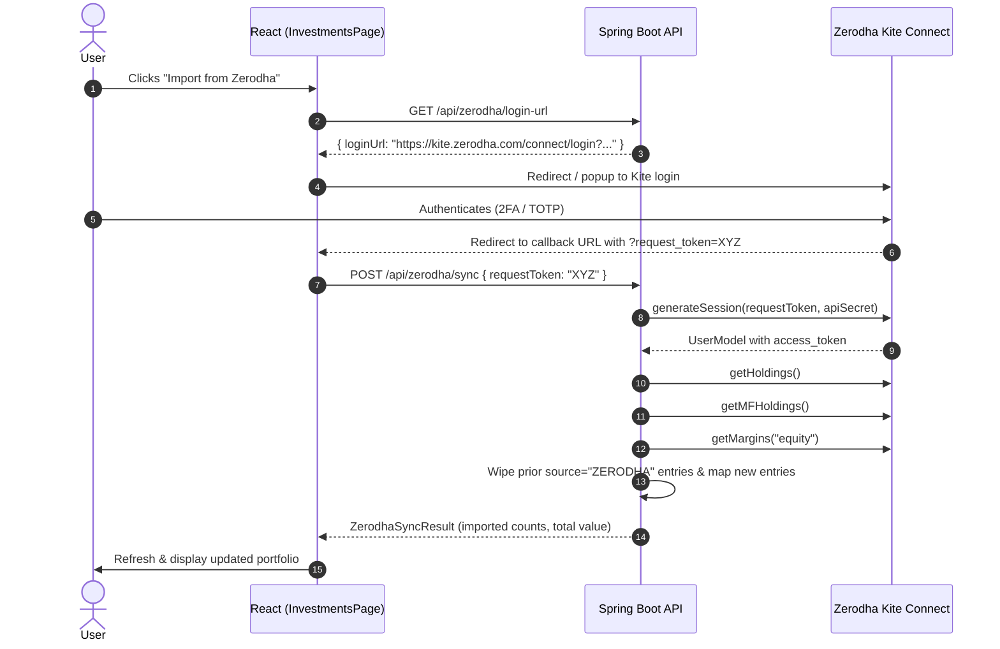

# Zerodha Portfolio Import — Design & Implementation Plan

## 1. Overview & Purpose

Enable users to directly import their Zerodha portfolio (Equities, ETFs, SGBs, Coin Mutual Funds, and Trading Cash Balance) into the NetWorth dashboard using Zerodha's official Java client (`com.zerodhatech.kiteconnect:kiteconnect:4.0.1`).

This complements the existing CAS (Consolidated Account Statement) PDF import by providing real-time, API-driven synchronization of stocks, ETFs, and broker-held mutual funds.

---

## 2. Scope & Target Assets

| Asset Type in Zerodha | Kite Connect API Method | Target NetWorth Instrument Type | Target Category | Notes |
|---|---|---|---|---|
| Stocks / Equities | `getHoldings()` | `EQUITY` | `DOMESTIC` | Name = Trading symbol / company name, units, avg cost, current value from LTP |
| ETFs | `getHoldings()` | `ETF` | `DOMESTIC` / `METALS` / `INTERNATIONAL` | Auto-categorized by symbol (e.g. `GOLDBEES` $\rightarrow$ `METALS`, `MON100` $\rightarrow$ `INTERNATIONAL`, others $\rightarrow$ `DOMESTIC`) |
| SGBs (Sovereign Gold Bonds) | `getHoldings()` | `BONDS` / `ETF` | `METALS` | Detected via `SGB*` symbol pattern $\rightarrow$ `METALS` |
| Coin Mutual Funds | `getMFHoldings()` | `EQUITY` / `DEBT` | `DOMESTIC` | Synced with scheme name, units, avg NAV, current value |
| Trading Balance / Cash | `getMargins("equity")` | `CASH_EQUIVALENT` | `LIQUID` | Named `"Zerodha Trading Balance"`, `available.cash` / `net` |

---

## 3. Authentication & Architecture

### Key Configuration
- Single-user / self-hosted mode:
  - `KITE_API_KEY`: Configured via environment variable (`application.yml` / `docker-compose.yml`).
  - `KITE_API_SECRET`: Configured via environment variable.
- Interactive login flow:
  1. Frontend asks backend for Kite login URL (`GET /api/zerodha/login-url`).
  2. Backend generates `https://kite.zerodha.com/connect/login?v=3&api_key={apiKey}`.
  3. Frontend opens/redirects user to Zerodha authentication page.
  4. Upon successful login, Zerodha redirects to configured callback URL with `?request_token=...&status=success`.
  5. Frontend captures `request_token` and calls backend `POST /api/zerodha/sync` with `{ requestToken }`.
  6. Backend exchanges `request_token` + `api_secret` for a session `access_token` using `KiteConnect.generateSession(requestToken, apiSecret)`.
  7. Backend fetches holdings, MF holdings, and margins, updates the user's `FinancialProfileDocument`, and discards the ephemeral `access_token`.



---

## 4. Deduplication & Merge Strategy

- **Source Tagging**: Every entry created by this import has `source = "ZERODHA"`.
- **Clean Replacement Policy**:
  - All existing items in `profile.investments` with `source == "ZERODHA"` are removed.
  - Newly fetched holdings, MF holdings, and cash balance are inserted with `source = "ZERODHA"`.
  - Items with `source == "MANUAL"` or `source == "CAS_IMPORT"` remain completely untouched.
  - This avoids duplicate accumulation across syncs while keeping manual overrides and CAS mutual funds intact.

---

## 5. API Endpoints

### 1. `GET /api/zerodha/login-url`
- **Summary**: Returns Kite Connect authorization URL.
- **Response**:
  ```json
  {
    "loginUrl": "https://kite.zerodha.com/connect/login?v=3&api_key=...",
    "configured": true
  }
  ```

### 2. `POST /api/zerodha/sync`
- **Summary**: Exchanges request token, fetches all portfolio assets, and updates investments.
- **Request Body**:
  ```json
  {
    "requestToken": "string"
  }
  ```
- **Response**:
  ```json
  {
    "equitiesCount": 15,
    "mutualFundsCount": 4,
    "cashBalance": 12500.50,
    "totalInvestedValue": 450000.00,
    "totalCurrentValue": 580000.00,
    "syncedAt": "2026-10-31T10:30:00Z"
  }
  ```

---

## 6. Implementation Tasks Breakdown

### Phase 1: Dependencies & Configuration
- [ ] Add `com.zerodhatech.kiteconnect:kiteconnect:4.0.1` dependency to `backend/pom.xml`.
- [ ] Add `kite.api-key` and `kite.api-secret` properties in `backend/src/main/resources/application.yml` with environment variable mappings (`KITE_API_KEY`, `KITE_API_SECRET`).
- [ ] Update `docker-compose.yml` to pass `KITE_API_KEY` and `KITE_API_SECRET` to the backend container.

### Phase 2: Backend Domain & Service Layer
- [ ] Create `ZerodhaSyncResult` DTO for API response summary.
- [ ] Create `ZerodhaSyncRequest` DTO containing `requestToken`.
- [ ] Create `ZerodhaService`:
  - `getLoginUrl()`: construct Kite login URL.
  - `syncPortfolio(userId, requestToken)`:
    - Initialize `KiteConnect(apiKey)`.
    - Generate session with `requestToken` + `apiSecret`.
    - Call `kiteSdk.getHoldings()`.
    - Call `kiteSdk.getMFHoldings()`.
    - Call `kiteSdk.getMargins("equity")`.
    - Categorize items (Equities, ETFs, SGBs $\rightarrow$ Metals, Cash $\rightarrow$ Liquid).
    - Filter user's profile investments: remove `source == "ZERODHA"`, append new entries.
    - Persist updated profile to MongoDB.

### Phase 3: Backend Controller & OpenAPI
- [ ] Create `ZerodhaController` with:
  - `GET /api/zerodha/login-url`
  - `POST /api/zerodha/sync`
- [ ] Update `backend/api/networth-api.yaml` with the new endpoints and models.

### Phase 4: Frontend UI Integration
- [ ] Create API service functions in `frontend/src/services/zerodha.js`:
  - `getZerodhaLoginUrl()`
  - `syncZerodhaPortfolio(requestToken)`
- [ ] Add Zerodha Connect & Sync component/button to `frontend/src/pages/InvestmentsPage.jsx`:
  - Positioned alongside CAS import dropzone.
  - Handles popup / redirect callback listener for `?request_token=...`.
  - Shows loading state during sync, success toast/summary banner, and auto-reloads profile.
- [ ] Add visual badge `ZERODHA` similar to the `LIVE` CAS badge.

### Phase 5: Verification & Testing
- [ ] Unit tests for `ZerodhaService` mapping logic (Equities, ETFs, SGBs, MFs, Margins).
- [ ] Verify clean replacement rule (no duplicates when sync is executed multiple times).
- [ ] Verify untouched status of `MANUAL` and `CAS_IMPORT` assets.
- [ ] Build verification with Maven (`mvn clean compile`).
